# Jackpot message graphs

Generated by `npm run graphs` from a sandbox run of the amended contracts against Hipo's real contracts (`tests/story/story.spec.ts`). Do not edit by hand. The graphs carry the operation and its token and principal amounts; no GRAM value, `query_id` or logical time, so they do not move with gas prices.

One story from start to finish: players deposit, Hipo's reward lands, a poke makes a boundary that fixes the pot, drand picks three winners, players leave, and at the end the Jackpot moves its last player to a successor, burns what is left and closes its tree. The number on an arrow is the order of its message in the chapter. Arrows with the same sender, receiver and operation are drawn once, with all their numbers. Under each graph are the Jackpot's numbers after that step, under their names in the code, with what changed in bold. The pot is shown at the stored rate, the rate of the last poke.

Boxes: the Jackpot, jGRAM wallets, hGRAM wallets, tree nodes, Hipo's contracts, another jetton's wallet, and people. Blue arrows move tokens, dashed arrows are returned GRAM (`gas_excess`), red arrows are a bounce or a failure.

## Chapters

**Deposits**

1. [Alice makes the first deposit](#alice-1)
2. [Bob deposits](#bob-1)

**A reward and an early poke**

3. [Hipo's reward lands](#reward-1)
4. [A poke that is not a boundary](#poke-early)

**Deposit options and a refusal**

5. [Carol deposits for Dave, with options](#carol-gift)
6. [Eve's deposit is refused: reason 5](#eve-refused)

**The boundary and the draw**

7. [The poke that is a boundary](#boundary)
8. [The draw: drand, the searches, three prizes](#draw)

**Withdrawals**

9. [Bob withdraws part by burn](#bob-burn)
10. [Alice withdraws everything with "w"](#alice-w)

**The float and a foreign jetton**

11. [A refill unstakes](#refill)
12. [A foreign jetton goes back](#foreign)

**The end**

13. [The governor retires the Jackpot and names a successor](#retire)
14. [withdraw_for pays Bob](#withdraw-for)
15. [withdraw_for moves Dave to the successor](#move)
16. [sweep: the rest burned, the tree closed](#sweep)

## Deposits

### 1. Alice makes the first deposit

Alice's wallet app sends hGRAM to the Jackpot with the deposit fee attached. Arrows 1 to 3 are an ordinary jetton transfer: her hGRAM wallet moves the tokens to the Jackpot's hGRAM wallet, which tells the Jackpot. The Jackpot does not book yet. It sends `prepare_deposit` to Alice's jGRAM wallet, with the wallet's StateInit, so the first deposit deploys it (5).

The wallet answers `deposit_ready` (6): no position yet. The booking happens there, in one Jackpot transaction, at the stored rate: this is the first deposit, so `principal` is 0 and there is no price, `booked_principal = deposit_value`. The rate starts at exactly 1 in this sandbox, so 100,000 hGRAM books 100,000 GRAM of principal, at position 0.

<picture>
  <source media="(prefers-color-scheme: dark)" srcset="graphs/alice-1-0-dark.svg">
  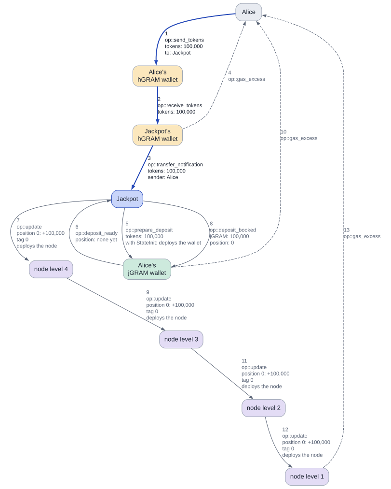
</picture>

Two things go out from the booking: the tree update (7, 9, 11, 12) and `deposit_booked` to the wallet (8), which credits 100,000 jGRAM. The first position deploys all four tree nodes, paid from the Jackpot's float. Alice's unused GRAM comes back on three arrows (4, 10, 13). The treasury is in none of this: no quote.

| held_tokens | reserved_tokens | free_tokens | pot, at the stored rate | principal | float, GRAM | stored rate | draw | tag |
| ---: | ---: | ---: | ---: | ---: | ---: | ---: | ---: | ---: |
| 100,000 | 0 | 100,000 | 0 | 100,000 | 39.32 | 1.000000 | none | 0 |

jGRAM: **Alice 100,000**

### 2. Bob deposits

The same shape as Alice's deposit. Bob's jGRAM wallet is new too, so `prepare_deposit` deploys it and `deposit_ready` says he has no position. The Jackpot gives him position 1.

The nodes over positions 0 to 63 already exist, so nothing new is deployed. Hipo's rate has not moved, so the pot is 0 and Bob pays no price.

<picture>
  <source media="(prefers-color-scheme: dark)" srcset="graphs/bob-1-0-dark.svg">
  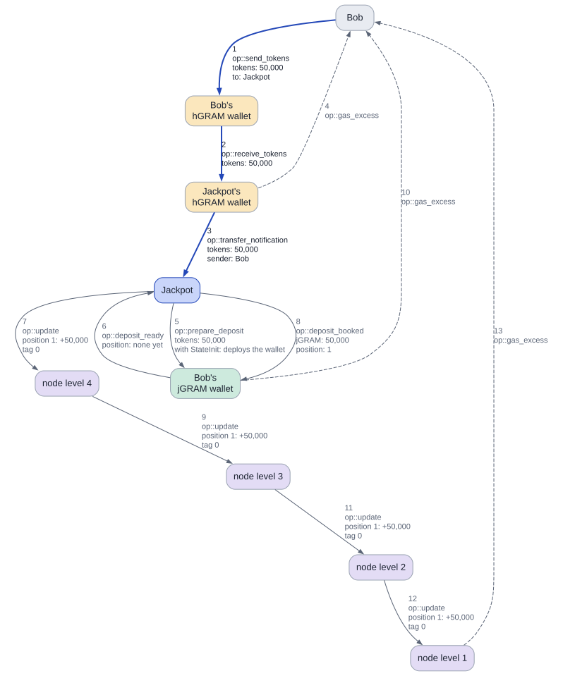
</picture>

| held_tokens | reserved_tokens | free_tokens | pot, at the stored rate | principal | float, GRAM | stored rate | draw | tag |
| ---: | ---: | ---: | ---: | ---: | ---: | ---: | ---: | ---: |
| **150,000** | 0 | **150,000** | 0 | **150,000** | 39.32 | 1.000000 | none | 0 |

jGRAM: Alice 100,000, **Bob 50,000**

## A reward and an early poke

### 3. Hipo's reward lands

Hipo's round ends and its rate rises 0.031%, the size of a real round today. **No message reaches the Jackpot**, so there is no graph, and none of its numbers change: it only learns the new rate when someone pokes. In this sandbox the reward is a gift to Hipo's treasury, standing in for a real round.

| held_tokens | reserved_tokens | free_tokens | pot, at the stored rate | principal | float, GRAM | stored rate | draw | tag |
| ---: | ---: | ---: | ---: | ---: | ---: | ---: | ---: | ---: |
| 150,000 | 0 | 150,000 | 0 | 150,000 | 39.32 | 1.000000 | none | 0 |

jGRAM: Alice 100,000, Bob 50,000

### 4. A poke that is not a boundary

Anyone may poke. Here the keeper does, two hours after deploy. The Jackpot asks Hipo's treasury for its rate (2), carrying the poke's context in the quote's `custom_payload`; the treasury echoes it back with the rate (3).

The reply stores the new rate, 1.000310. It is **not a boundary**: the rate has risen past `rise_min`, but `min_gap` (32,768 s, about nine hours) has not passed since the last boundary, here the deploy. So the reply only stores the rate and sends the rest of the GRAM back to the keeper (4). The pot in the numbers below now shows the yield on the hGRAM the Jackpot holds.

<picture>
  <source media="(prefers-color-scheme: dark)" srcset="graphs/poke-early-0-dark.svg">
  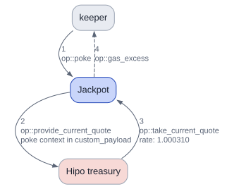
</picture>

| held_tokens | reserved_tokens | free_tokens | pot, at the stored rate | principal | float, GRAM | stored rate | draw | tag |
| ---: | ---: | ---: | ---: | ---: | ---: | ---: | ---: | ---: |
| 150,000 | 0 | 150,000 | **46.49** | 150,000 | 39.32 | **1.000310** | none | 0 |

jGRAM: Alice 100,000, Bob 50,000

## Deposit options and a refusal

### 5. Carol deposits for Dave, with options

Carol deposits 30,000 hGRAM **for Dave**, with `deposit_options` in the transfer's payload: Dave as beneficiary, a `min_principal` of 29,859.254 (she accepts a price of up to 0.5%), and a forward amount of 0.01 GRAM with the comment "A gift from Carol". Her app attaches the deposit fee plus that 0.01 and the payload's fee.

The context in `prepare_deposit` (5) names Dave as owner, so it goes to Dave's jGRAM wallet and deploys it. At the stored rate her hGRAM is worth 30,009.3 GRAM, and the pot is not 0, so she pays the entry price: she books **30,000 GRAM** and 9.3 GRAM goes into the pot. That price is her share of the pot she is joining, so on average Dave wins it back.

<picture>
  <source media="(prefers-color-scheme: dark)" srcset="graphs/carol-gift-0-dark.svg">
  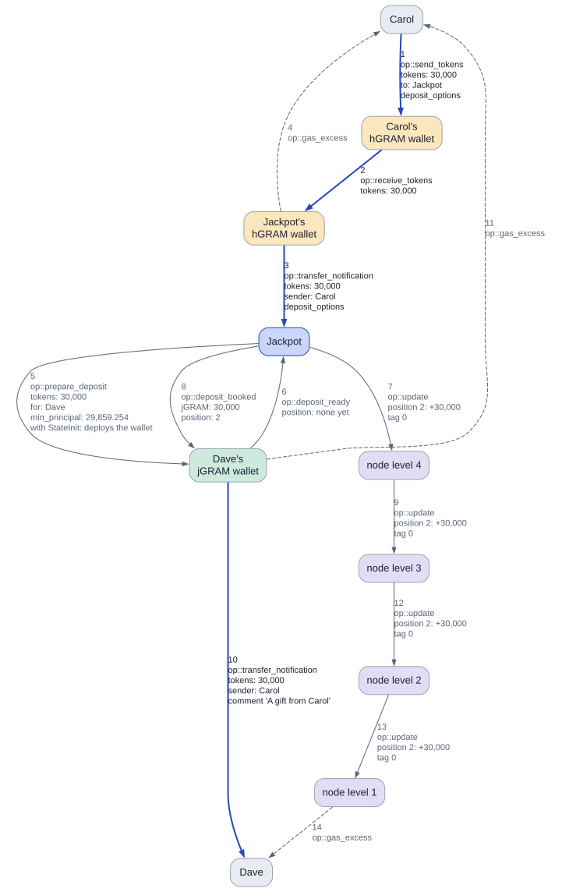
</picture>

New here: Dave's jGRAM wallet sends Dave a `transfer_notification` (10) with Carol's comment and her 0.01 GRAM, as any jetton wallet does. The leftover GRAM goes to Carol, the response destination (11). The last of the tree update goes to Dave (14), the beneficiary.

| held_tokens | reserved_tokens | free_tokens | pot, at the stored rate | principal | float, GRAM | stored rate | draw | tag |
| ---: | ---: | ---: | ---: | ---: | ---: | ---: | ---: | ---: |
| **180,000** | 0 | **180,000** | **55.78** | **180,000** | **39.33** | 1.000310 | none | 0 |

jGRAM: Alice 100,000, Bob 50,000, **Dave 30,000**

### 6. Eve's deposit is refused: reason 5

Eve sends 1,000 hGRAM with a `min_principal` of 999,999 GRAM, which no deposit of that size can meet, and asks for a 0.01 GRAM forward amount. Up to `deposit_ready` (6) it looks like any first deposit. There the Jackpot works out the price, 1,000 GRAM of principal for 1,000.31 GRAM of value, and refuses it with **reason 5, `price`**.

The refusal is one step: `deposit_cancelled` to her new wallet, which deletes itself and returns its GRAM (7, 9), and the 1,000 hGRAM back to Eve (8, 10). Because she sent options with a forward amount, the refund carries `deposit_refused` with the reason code as its payload, and her hGRAM wallet notifies her (11). A deposit without options would get the comment "Hipo Jackpot: deposit returned (entry price above your limit)" instead. Nothing in the Jackpot's numbers changed; she lost only gas.

<picture>
  <source media="(prefers-color-scheme: dark)" srcset="graphs/eve-refused-0-dark.svg">
  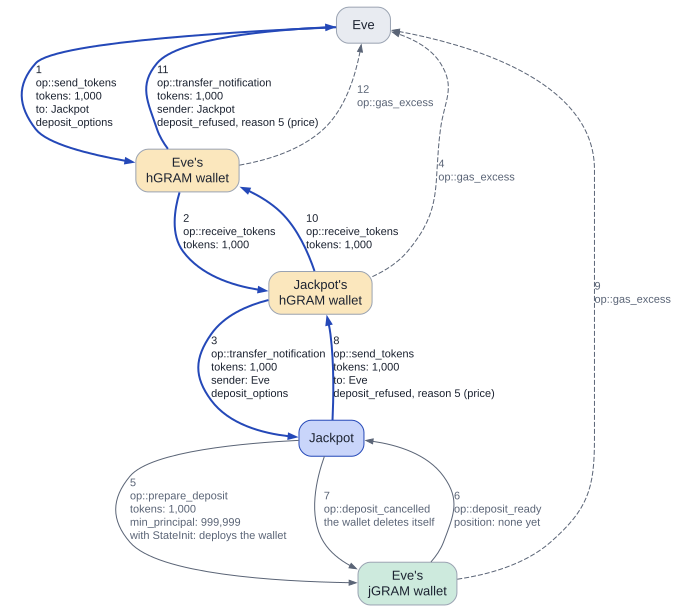
</picture>

| held_tokens | reserved_tokens | free_tokens | pot, at the stored rate | principal | float, GRAM | stored rate | draw | tag |
| ---: | ---: | ---: | ---: | ---: | ---: | ---: | ---: | ---: |
| 180,000 | 0 | 180,000 | 55.78 | 180,000 | 39.33 | 1.000310 | none | 0 |

jGRAM: Alice 100,000, Bob 50,000, Dave 30,000

## The boundary and the draw

### 7. The poke that is a boundary

Nine hours later the next reward lands, and the keeper pokes. This time `min_gap` has passed and the rate has risen past `rise_min` since the deploy, so the reply (3) **is a boundary**, and the boundary's work runs inside that same transaction: `tag` becomes 1, the snapshot takes all 180,000 tickets, and the pot is fixed at the new rate 1.000620: **111.548 hGRAM**, the yield of both rewards.

Before this poke the float was set to 7.5 GRAM by hand, below the low mark of 8, so the boundary also unstakes: 7.495 hGRAM, enough to bring the float back to 15 (4). From the rest, 10% is the burn, 10.405 hGRAM, and the prizes are 46.824, 28.094, 18.729 hGRAM. They are set aside in `reserved_tokens`. The drand round is fixed too: 35743295. Nothing about this draw can change once that round is published.

**The poke, the quote, and the boundary in the reply**

<picture>
  <source media="(prefers-color-scheme: dark)" srcset="graphs/boundary-0-dark.svg">
  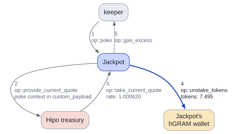
</picture>

**Hipo burns the unstaked hGRAM and sends GRAM back**

<picture>
  <source media="(prefers-color-scheme: dark)" srcset="graphs/boundary-1-dark.svg">
  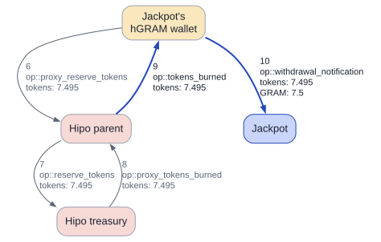
</picture>

The second graph is Hipo's own instant unstake: Hipo burns the hGRAM and its parent passes the GRAM back to the Jackpot's hGRAM wallet, which sends the Jackpot `withdrawal_notification` with 7.5 GRAM (10). The keeper got back what a plain poke returns (5): the float paid the boundary's gas.

| held_tokens | reserved_tokens | free_tokens | pot, at the stored rate | principal | float, GRAM | stored rate | draw | tag |
| ---: | ---: | ---: | ---: | ---: | ---: | ---: | ---: | ---: |
| **179,992.5** | **104.05** | **179,888.45** | **0** | 180,000 | **14.99** | **1.000620** | **waiting** | **1** |

jGRAM: Alice 100,000, Bob 50,000, Dave 30,000

### 8. The draw: drand, the searches, three prizes

drand has published round 35743295, and the keeper brings its signature (1). `submit_randomness` no longer asks for a quote: the pot was fixed at the boundary. The Jackpot checks the signature, mixes it with the masterchain block hash stored at the boundary to make the seed, and sends three searches into the tree, one per prize (2 to 4). The keeper gets the rest of its GRAM back plus a 0.02 GRAM reward (5).

Each search walks down the four levels, and the level-1 node answers by itself. All three are hits this time: 1st 46.824 hGRAM to Bob, 2nd 28.094 hGRAM to Alice, 3rd 18.729 hGRAM to Bob.

**The submit and the three searches down the tree**

<picture>
  <source media="(prefers-color-scheme: dark)" srcset="graphs/draw-0-dark.svg">
  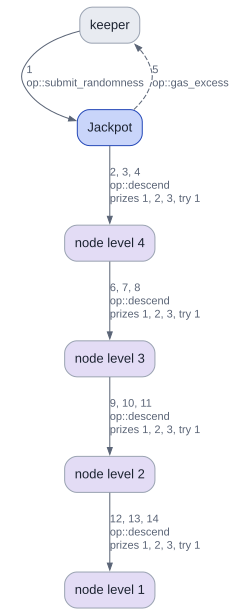
</picture>

**Three hits, three prizes with their notifications, and the burn**

<picture>
  <source media="(prefers-color-scheme: dark)" srcset="graphs/draw-1-dark.svg">
  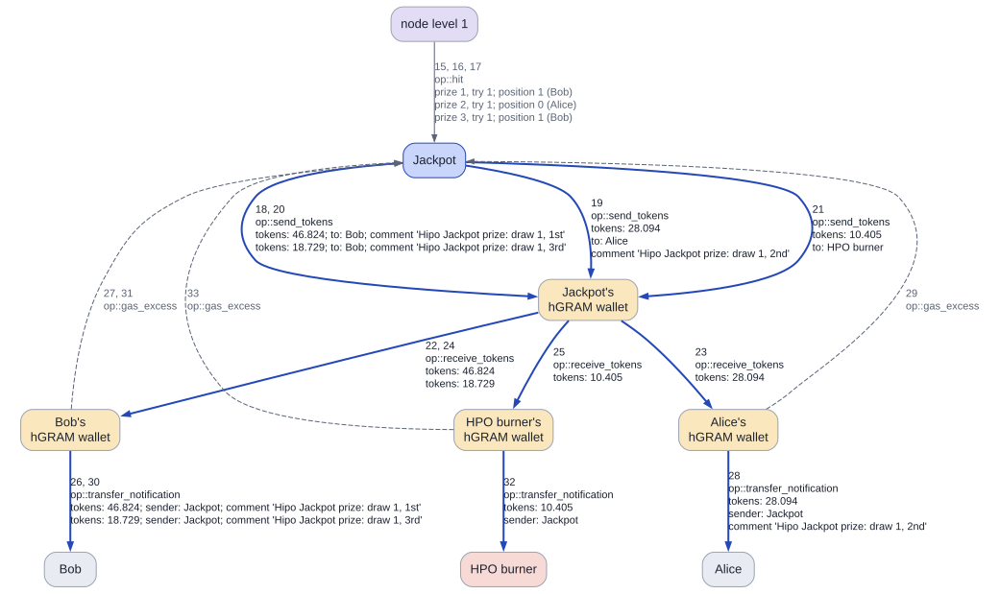
</picture>

Each prize is an hGRAM transfer with 0.01 GRAM forward and a comment naming the draw and the place, so the winner's hGRAM wallet sends a notification (the `transfer_notification` arrows to Bob and Alice). The Jackpot does not wait to hear that a payout arrived: the `gas_excess` arrows back to it are ignored. When the last prize is paid the draw ends, and the burn owed, 10.405 hGRAM, is above this story's batch of 5, so it goes to the burner in the same step.

| held_tokens | reserved_tokens | free_tokens | pot, at the stored rate | principal | float, GRAM | stored rate | draw | tag |
| ---: | ---: | ---: | ---: | ---: | ---: | ---: | ---: | ---: |
| **179,888.45** | **0** | 179,888.45 | 0 | 180,000 | **14.42** | 1.000620 | **none** | 1 |

jGRAM: Alice 100,000, Bob 50,000, Dave 30,000

## Withdrawals

### 9. Bob withdraws part by burn

Bob takes out 20,000 GRAM with a standard TEP-74 `burn` on his jGRAM wallet (1). The burn's `custom_payload` holds `withdraw_options`: a 0.02 GRAM forward amount and the comment "Savings app: order 17", the kind of thing an app would send. Its `query_id` rides along on every message.

The wallet lowers his balance and sends `burn_notification` (2). The Jackpot pays in that same step, at the stored rate 1.000620: 19,987.606 hGRAM for 20,000 GRAM of principal. It sends the tree update (3) and the payout (4) together, and Bob's hGRAM wallet notifies him with his own payload (8). No quote, no confirmation, and nothing passes back through the Jackpot. Bob keeps 30,000 jGRAM and his position.

<picture>
  <source media="(prefers-color-scheme: dark)" srcset="graphs/bob-burn-0-dark.svg">
  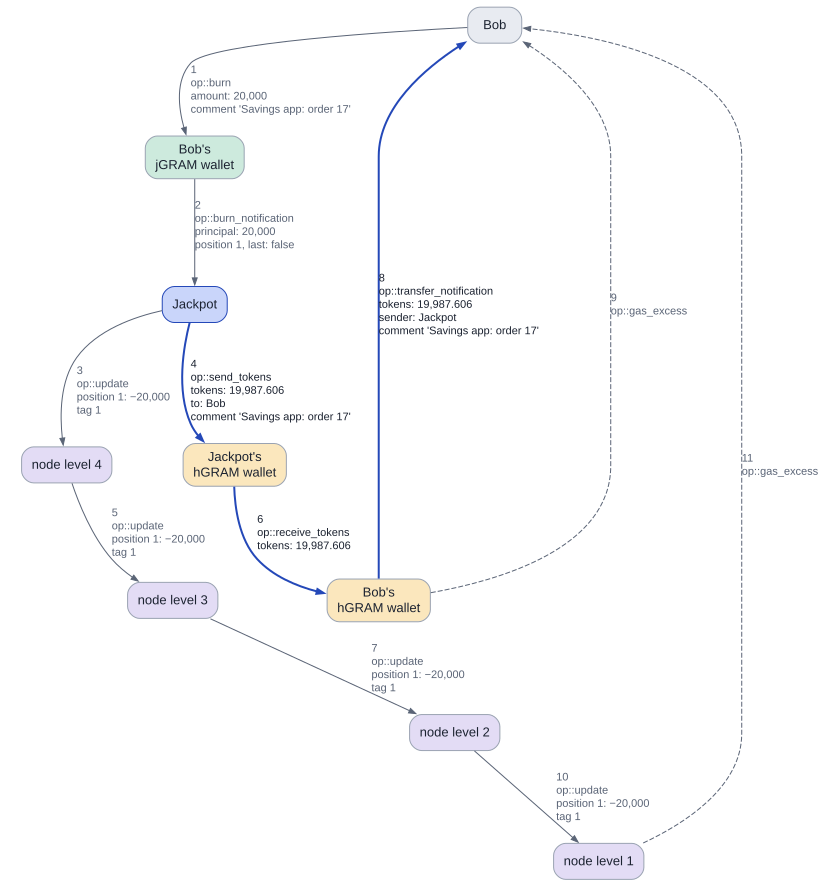
</picture>

| held_tokens | reserved_tokens | free_tokens | pot, at the stored rate | principal | float, GRAM | stored rate | draw | tag |
| ---: | ---: | ---: | ---: | ---: | ---: | ---: | ---: | ---: |
| **159,900.85** | 0 | **159,900.85** | 0 | **160,000** | 14.42 | 1.000620 | none | 1 |

jGRAM: Alice 100,000, **Bob 30,000**, Dave 30,000

### 10. Alice withdraws everything with "w"

Alice sends the Jackpot the fee with the text comment `w`, from any wallet app (1). The Jackpot turns it into a burn of everything on her jGRAM wallet (2), with the wallet's StateInit in case it did not exist.

Her balance is now 0, so `burn_notification` says `last: true` (3). The Jackpot pays 99,938.029 hGRAM for her 100,000 GRAM of principal, with the comment "Hipo Jackpot withdrawal" and 1 nano-GRAM so it shows in her wallet (6, 9, 11), and sends `close_wallet` (5): the wallet deletes itself and returns its storage reserve (8). Her position 0 is never used again.

<picture>
  <source media="(prefers-color-scheme: dark)" srcset="graphs/alice-w-0-dark.svg">
  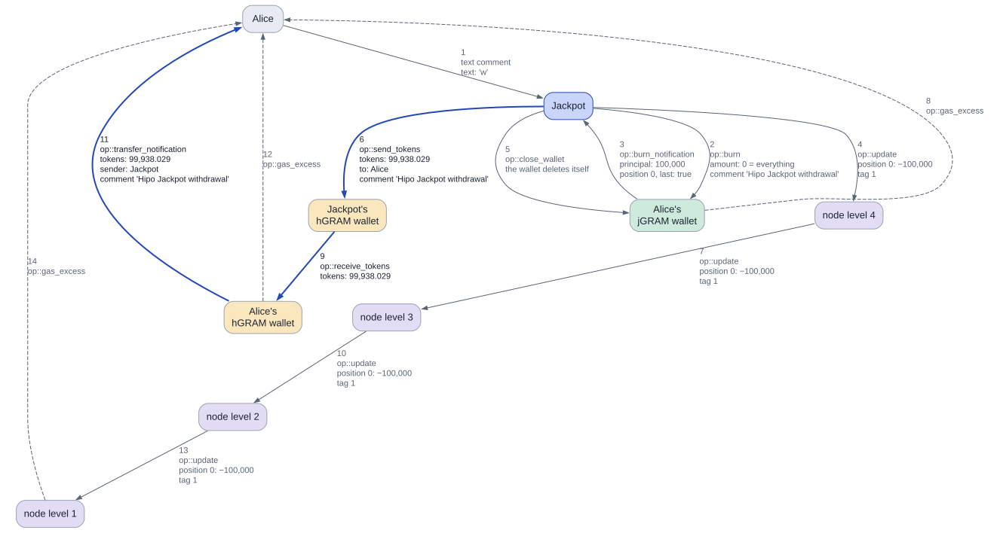
</picture>

| held_tokens | reserved_tokens | free_tokens | pot, at the stored rate | principal | float, GRAM | stored rate | draw | tag |
| ---: | ---: | ---: | ---: | ---: | ---: | ---: | ---: | ---: |
| **59,962.82** | 0 | **59,962.82** | 0 | **60,000** | 14.42 | 1.000620 | none | 1 |

jGRAM: **Alice 0**, Bob 30,000, Dave 30,000

## The float and a foreign jetton

### 11. A refill unstakes

Before this step: a third reward and a poke that was not a boundary, so the stored rate is 1.000930 and a pot of new yield is free again. Then the float was set to 3.5 GRAM by hand, below what a draw needs (`fee::draw_budget`).

Anyone may send `refill` then; here Frank does (1). It asks for no quote: it unstakes at the stored rate, at most a fifth of the free pot, here 3.717 hGRAM (2). The rest of Frank's GRAM comes back (3), and Hipo's instant unstake brings 3.72 GRAM into the float (8), the same chain as at the boundary.

<picture>
  <source media="(prefers-color-scheme: dark)" srcset="graphs/refill-0-dark.svg">
  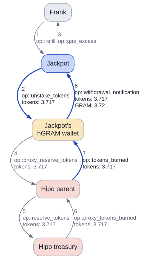
</picture>

| held_tokens | reserved_tokens | free_tokens | pot, at the stored rate | principal | float, GRAM | stored rate | draw | tag |
| ---: | ---: | ---: | ---: | ---: | ---: | ---: | ---: | ---: |
| **59,959.1** | 0 | **59,959.1** | **14.87** | 60,000 | **7.24** | **1.000930** | none | 1 |

jGRAM: Bob 30,000, Dave 30,000

### 12. A foreign jetton goes back

Frank sends the Jackpot 25 tokens of some other jetton, XYZ, by mistake, with 0.15 GRAM forward. The Jackpot's XYZ wallet is deployed by the transfer and notifies the Jackpot (3). The notification does not come from the Jackpot's own hGRAM wallet, so the Jackpot treats it as foreign: nothing is booked and no counter moves.

The value covers `fee::foreign_return`, so it sends the 25 XYZ straight back with a TEP-74 transfer to the wallet that notified it (5), paid entirely from the notification's own value, with the comment "Hipo Jackpot: this token is not accepted" (7). In this sandbox XYZ is Hipo's wallet code under a stand-in minter: a real TEP-74 wallet of a different jetton.

<picture>
  <source media="(prefers-color-scheme: dark)" srcset="graphs/foreign-0-dark.svg">
  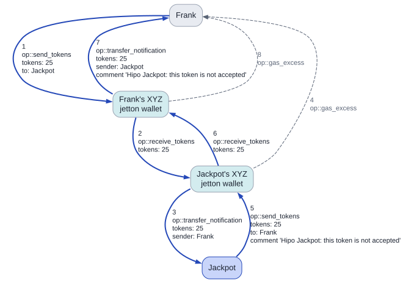
</picture>

| held_tokens | reserved_tokens | free_tokens | pot, at the stored rate | principal | float, GRAM | stored rate | draw | tag |
| ---: | ---: | ---: | ---: | ---: | ---: | ---: | ---: | ---: |
| 59,959.1 | 0 | 59,959.1 | 14.87 | 60,000 | 7.24 | 1.000930 | none | 1 |

jGRAM: Bob 30,000, Dave 30,000

## The end

### 13. The governor retires the Jackpot and names a successor

The governor sends `retire` (1). From now on deposits are refused with reason `retired`, and nothing can clear it. Withdrawals, `w`, boundaries and draws keep working. Then it names a successor (2), a new Jackpot deployed in the same sandbox, with the GRAM each move must send it for its deposit fee: 0.1654 GRAM.

Each is one message with a log and no reply. In a real end the governor would now wait for the next boundary and its draw, which pays the last pot to the players. This story goes straight on.

<picture>
  <source media="(prefers-color-scheme: dark)" srcset="graphs/retire-0-dark.svg">
  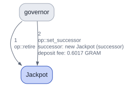
</picture>

| held_tokens | reserved_tokens | free_tokens | pot, at the stored rate | principal | float, GRAM | stored rate | draw | tag |
| ---: | ---: | ---: | ---: | ---: | ---: | ---: | ---: | ---: |
| 59,959.1 | 0 | 59,959.1 | 14.87 | 60,000 | **7.34** | 1.000930 | none | 1 |

jGRAM: Bob 30,000, Dave 30,000, **retired**

### 14. withdraw_for pays Bob

The governor withdraws for Bob (1): `withdraw_for` lists up to 100 owners and pays the gas for each. The Jackpot sends Bob's jGRAM wallet the same burn a `w` sends (2), and returns what is above the cost to the governor (3).

From there it is Alice's `w` again: Bob's 30,000 GRAM of principal is paid to Bob himself as 29,972.117 hGRAM, with the comment "Hipo Jackpot withdrawal", and his wallet closes. The governor chooses only whom to process, never where the hGRAM goes.

<picture>
  <source media="(prefers-color-scheme: dark)" srcset="graphs/withdraw-for-0-dark.svg">
  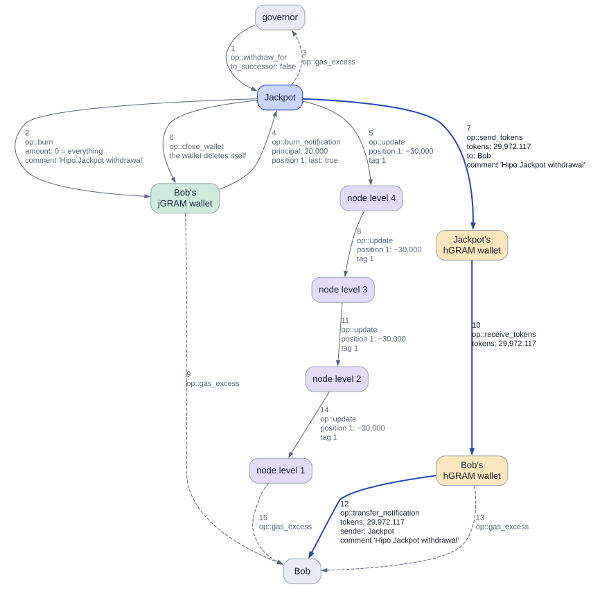
</picture>

| held_tokens | reserved_tokens | free_tokens | pot, at the stored rate | principal | float, GRAM | stored rate | draw | tag |
| ---: | ---: | ---: | ---: | ---: | ---: | ---: | ---: | ---: |
| **29,986.98** | 0 | **29,986.98** | 14.87 | **30,000** | 7.34 | 1.000930 | none | 1 |

jGRAM: **Bob 0**, Dave 30,000

### 15. withdraw_for moves Dave to the successor

Now `withdraw_for` with `to_successor: true` for Dave (1). The burn carries that flag (2), and since a successor is set and the value covers its deposit fee, the payout of 29,972.117 hGRAM goes to the **new Jackpot** as a deposit (7), with `deposit_options` the old Jackpot builds itself: Dave as beneficiary and response destination, and a `min_principal` of 29,700 (a price of at most 1%).

In the second graph the successor runs an ordinary first deposit: it deploys Dave's jGRAM wallet there, books 30,000 GRAM of principal at position 0, deploys its own four nodes, and notifies Dave with the comment "Hipo Jackpot: moved". Dave's principal survived the move to the last rounding nano-GRAM. Had the new Jackpot refused, its refund would have gone to Dave's own hGRAM wallet, never back to the old one.

**The old Jackpot burns Dave's jGRAM and pays his hGRAM into the successor**

<picture>
  <source media="(prefers-color-scheme: dark)" srcset="graphs/move-0-dark.svg">
  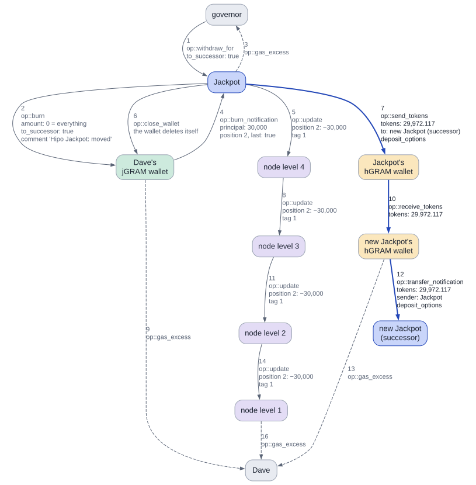
</picture>

**The successor books it for Dave**

<picture>
  <source media="(prefers-color-scheme: dark)" srcset="graphs/move-1-dark.svg">
  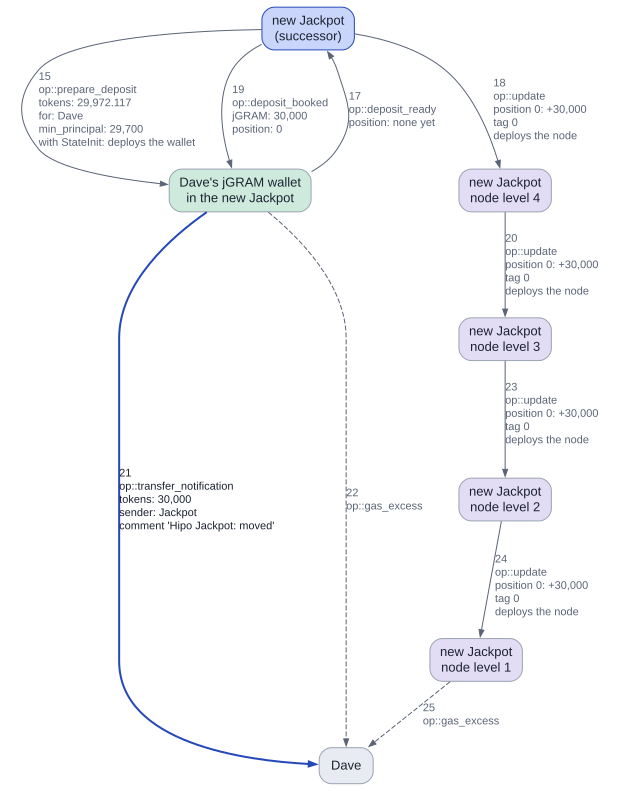
</picture>

| held_tokens | reserved_tokens | free_tokens | pot, at the stored rate | principal | float, GRAM | stored rate | draw | tag |
| ---: | ---: | ---: | ---: | ---: | ---: | ---: | ---: | ---: |
| **14.87** | 0 | **14.87** | 14.87 | **0** | 7.34 | 1.000930 | none | 1 |

jGRAM: **Dave 0**, **Dave 30,000 in the new Jackpot**

### 16. sweep: the rest burned, the tree closed

Nobody is owed anything now: `principal` is 0. Anyone may send `sweep`; the governor does, bringing `fee::sweep` plus the cost of closing the tree (1). What the Jackpot still holds, 14.866 hGRAM, goes to the burner (2, 5, 8). That is the yield since the last boundary, from the third reward, plus rounding: it is here only because this story did not wait for a last draw.

Then `close_node` goes to the top node (3). Each node checks that every sum under it is 0, forwards `close_node` to each child that exists, and deletes itself, sending its whole balance, storage reserve included, back to the Jackpot. The float rose from 7.34 to 8.12 GRAM. All four nodes are gone, and the Jackpot is at its end.

**The rest goes to the burner**

<picture>
  <source media="(prefers-color-scheme: dark)" srcset="graphs/sweep-0-dark.svg">
  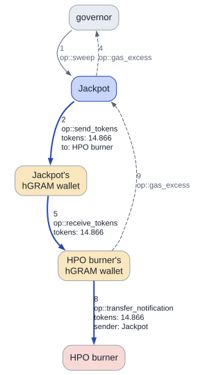
</picture>

**close_node deletes the tree from the top down**

<picture>
  <source media="(prefers-color-scheme: dark)" srcset="graphs/sweep-1-dark.svg">
  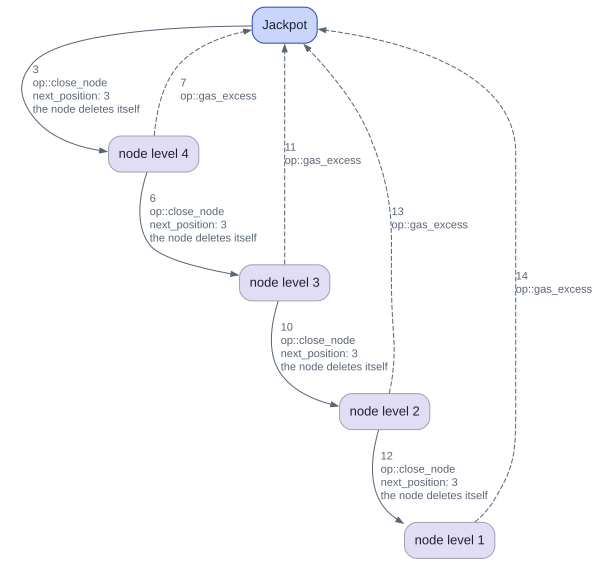
</picture>

| held_tokens | reserved_tokens | free_tokens | pot, at the stored rate | principal | float, GRAM | stored rate | draw | tag |
| ---: | ---: | ---: | ---: | ---: | ---: | ---: | ---: | ---: |
| **0** | 0 | **0** | **0** | 0 | **8.12** | 1.000930 | none | 1 |

jGRAM: Dave 30,000 in the new Jackpot, **tree nodes left: 0**

## Run details

The amended contracts against Hipo's real contracts in the sandbox, with mainnet's global version, so bounceable messages ask for full-body bounces. Hipo's rate starts at 1 here, and each reward is a gift of 0.031% to Hipo's treasury. `min_gap` is the spec's 32,768 s and `rise_min` its 50 ppm. The drand check is the test build, which skips the pairing; the seed is made from the signature and the block hash as in production. The burn batch is 5 hGRAM instead of 50, so a burn shows up. The float was set by hand twice: to 7.5 GRAM before the boundary, so that it unstakes, and to 3.5 GRAM before the refill. Each player's hGRAM was minted before chapter 1. The foreign jetton is Hipo's wallet code under a stand-in minter, and the successor is a second Jackpot built from the same code.
